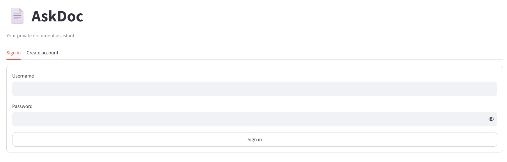
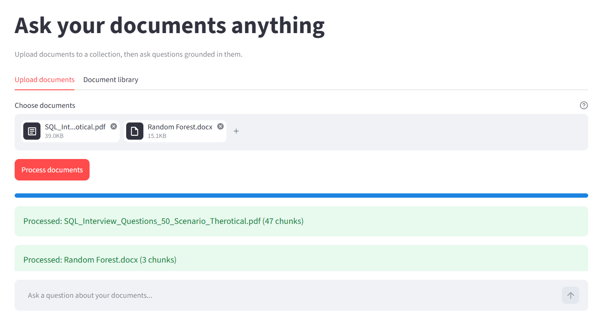
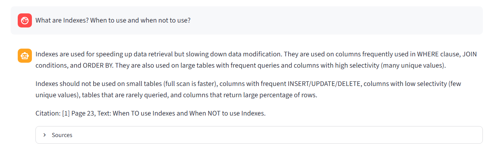
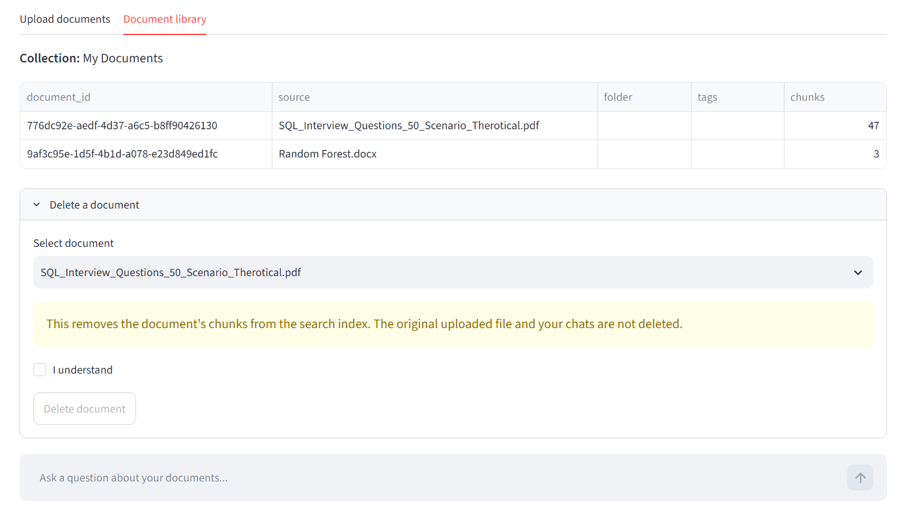
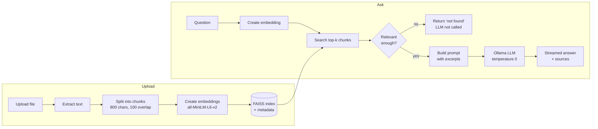

# 📄 AskDoc

**A private document Q&A app that runs on your own computer.**

Upload your documents, ask questions, and get answers based only on those documents. Every answer shows its sources.


---

## About the project

AskDoc is a RAG (Retrieval-Augmented Generation) app. It finds the most relevant parts of your documents and gives them to a local LLM, so the answer comes from your files and not from the model's own knowledge.

If the documents do not contain the answer, the app says "not found" instead of guessing.

Everything runs locally: the embeddings, the search and the LLM. Your documents stay on your computer.

---

## Features

- Upload PDF, DOCX, TXT, Markdown, HTML and CSV files
- Ask questions and get answers that stream live
- See the sources for every answer: file name, page, similarity score and text
- Answers only from your documents. If nothing relevant is found, the LLM is not called
- Sign up and sign in. Passwords are stored as salted hashes (PBKDF2-SHA256)
- Each user has their own data
- Collections to group documents. Each collection has its own search index
- Document library: see your documents, delete one, or clear all
- Chat history saved for each collection
- 👍 / 👎 feedback buttons
- Admin dashboard with event counts
- Error history in the app and log files for debugging

---

## Screenshots

### Sign in


### Upload documents


### Ask a question and see the sources


### Document library


---

## How it works



**Upload steps**
1. The text is extracted from the file (page by page for PDFs).
2. The text is split into chunks of 800 characters with 100 characters of overlap.
3. Each chunk is converted into a vector with the `all-MiniLM-L6-v2` model.
4. The vectors are saved in a FAISS index, and the chunk details are saved in a JSON file.

**Question steps**
1. The question is converted into a vector.
2. FAISS finds the most similar chunks.
3. A chunk is kept only if its similarity score is at least `MIN_SIMILARITY` (default 0.45) and it shares enough keywords with the question.
4. If no chunk is kept, the app returns a "not found" message.
5. Otherwise, the kept chunks are sent to the Ollama model with a strict prompt: use only these excerpts.

---

## Tech stack

| Part | Tool |
|---|---|
| User interface | Streamlit |
| Embeddings | sentence-transformers (`all-MiniLM-L6-v2`) |
| Vector search | FAISS |
| LLM | Ollama (default model: `mistral`) |
| Database | SQLite |
| File reading | pypdf, python-docx, BeautifulSoup, pandas |
| Chunking | langchain-text-splitters |

---

## Project structure

```
AskDoc/
├── app.py                  # Streamlit app: login, collections, chats, upload, admin
├── rag.py                  # RAG code: read files, chunk, FAISS, search, answer
├── diagnose_sources.py     # Checks for stray characters in extracted text
├── requirements.txt
├── .env.example
├── .gitignore
├── uploads/                # created when the app runs: uploaded files
├── vectorstore/            # created when the app runs: FAISS index and metadata
├── logs/                   # created when the app runs: log files
└── askdoc_app.db           # created when the app runs: SQLite database
```

---

## Database tables

| Table | What it stores |
|---|---|
| `users` | Username, password hash, salt, role |
| `collections` | Document collections for each user |
| `chats` | Chats inside a collection |
| `messages` | Questions and answers, with their sources |
| `feedback` | 👍 / 👎 ratings |
| `events` | Activity log used by the admin dashboard |

---

## Getting started

**You need:** Python 3, [Ollama](https://ollama.com/download) and a recent version of Streamlit.

```bash
# 1. Clone the project
git clone https://github.com/gangurdesagar03/AskDoc.git
cd AskDoc

# 2. Create a virtual environment
python -m venv venv
source venv/bin/activate          # Windows: venv\Scripts\activate

# 3. Install the packages
pip install -r requirements.txt

# 4. Download the LLM (one time)
ollama pull mistral

# 5. Run the app
streamlit run app.py
```

Open http://localhost:8501, create an account, upload a document and ask a question. The embedding model downloads automatically the first time.

---

## Configuration

Copy `.env.example` to `.env` if you want to change the defaults.

| Variable | Default | Meaning |
|---|---|---|
| `EMBEDDING_MODEL` | `all-MiniLM-L6-v2` | Embedding model. Upload your documents again if you change it |
| `OLLAMA_MODEL` | `mistral` | LLM used for answers |
| `OLLAMA_HOST` | `http://127.0.0.1:11434` | Ollama server address |
| `CHUNK_SIZE` | `800` | Characters in each chunk |
| `CHUNK_OVERLAP` | `100` | Characters shared between chunks |
| `DEFAULT_TOP_K` | `5` | Chunks retrieved for each question |
| `MIN_SIMILARITY` | `0.45` | Lowest similarity score to keep a chunk |
| `MAX_FILE_MB` | `20` | Largest file size allowed |

---

## Troubleshooting

| Problem | Fix |
|---|---|
| `Could not reach Ollama or model ...` | Start Ollama and run `ollama pull mistral`. |
| `Embedding model changed. Re-index documents.` | You changed `EMBEDDING_MODEL`. Clear the documents in the collection and upload them again. |
| `No readable text found in PDF` | The PDF is a scan (image). Use a PDF that has selectable text. |
| Always getting "not found" | Lower `MIN_SIMILARITY` a little, or use words that appear in your document. |
| Strange characters in the Sources panel | Run `python diagnose_sources.py` to see if they come from the document or from the display. |

---

## Author

**Sagar Gangurde**

[GitHub](https://github.com/gangurdesagar03) · [LinkedIn](https://www.linkedin.com/in/sagar-gangurde-85025331b/)

---

## License

No license is granted. All rights are reserved by the author. You are welcome to view the code. If you want to use, copy or change it, please contact the author first.
